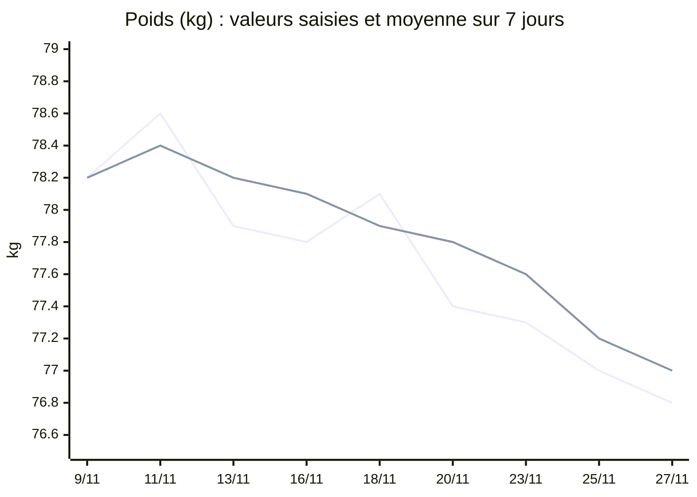
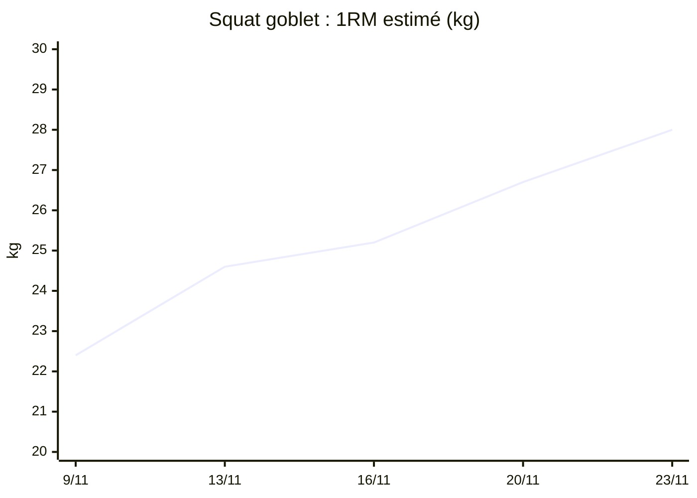

# Recompo 16

Web app installable (PWA) qui accompagne un **programme de recomposition corporelle de 16 semaines** : musculation progressive, cardio, nutrition, sommeil et suivi des progrès.

- **Hors ligne** : tout fonctionne en mode avion une fois l'app installée.
- **Privée** : toutes les données restent sur le téléphone (pas de compte, pas de serveur).
- **Sans abonnement ni App Store** : elle s'installe depuis Safari.

> Installation sur iPhone, mise en ligne et organisation du code : voir [LISEZMOI.md](LISEZMOI.md).

---

## Sommaire

1. [Vue d'ensemble des onglets](#1-vue-densemble-des-onglets)
2. [Le programme sur 16 semaines](#2-le-programme-sur-16-semaines)
3. [Onglet Aujourd'hui](#3-onglet-aujourdhui)
4. [Onglet Calendrier](#4-onglet-calendrier)
5. [Onglet Séance : musculation](#5-onglet-séance--musculation)
6. [Onglet Séance : cardio](#6-onglet-séance--cardio)
7. [Onglet Progrès](#7-onglet-progrès)
8. [Onglet Guide](#8-onglet-guide)
9. [Onglet Réglages](#9-onglet-réglages)
10. [Données et sauvegarde](#10-données-et-sauvegarde)
11. [Une semaine type, de bout en bout](#11-une-semaine-type-de-bout-en-bout)

---

## 1. Vue d'ensemble des onglets

| Onglet | À quoi il sert |
|---|---|
| **Aujourd'hui** | Activité du jour, cibles (calories, protéines, eau, pas, sommeil, poids), journée heure par heure avec repas et compléments, note du jour. |
| **Calendrier** | Les 16 semaines d'un coup d'œil, par phase, avec les jours faits. |
| **Séance** | Séance de musculation guidée (objectif de charge, saisie des séries, minuteur de repos, bilan) ou minuteur de cardio. |
| **Progrès** | Courbes de poids et de tour de taille, conseil d'ajustement calorique, mesures, force par exercice, régularité. |
| **Guide** | Tout le contenu du programme, lisible hors ligne, plus les 30 fiches exercices illustrées. |
| **Réglages** | Date de début, horaire des séances, sauvegarde, import, remise à zéro. |

---

## 2. Le programme sur 16 semaines

### Phases

| Phase | Semaines | Nom | Structure |
|---|---|---|---|
| 1 | S1–S4 | Fondations | 3 × full body par semaine (A / B en alternance) |
| 2 | S5–S8 | Construction | 4 séances haut / bas |
| 3 | S9–S12 | Progression | 4 séances haut / bas, charges plus lourdes |
| 4 | S13–S16 | Intensification | 4 séances haut / bas, séries les plus lourdes |

Les **semaines 8 et 16 sont des décharges** : moitié moins de séries, charges −10 %, RIR 3.

### Semaine type

| Jour | Phase 1 | Phases 2 à 4 |
|---|---|---|
| Lundi | Full body A ou B | Haut A |
| Mardi | Cardio zone 2 | Bas A |
| Mercredi | Full body A ou B | Cardio zone 2 |
| Jeudi | Repos actif | Haut B |
| Vendredi | Full body A ou B | Bas B |
| Samedi | Cardio zone 2 · piscine | Zone 2 (S5), puis intervalles vélo (S6 et après) |
| Dimanche | Repos | Repos |

En phase 1, les semaines impaires suivent **A – B – A** et les semaines paires **B – A – B**.

### Les 6 séances

| Séance | Exercices |
|---|---|
| **Full body A** | Squat goblet sur box · Développé couché haltères · Tirage horizontal · Pont fessier · Développé militaire · Planche · Chaise contre le mur · Abduction de hanche |
| **Full body B** | Soulevé de terre roumain · Presse à cuisses · Tirage vertical · Pompes inclinées · Leg curl · Dead bug · Step-up · Extension terminale du genou |
| **Haut A** | Développé couché · Tirage horizontal · Développé militaire · Tirage vertical · Élévations latérales · Curl · Extension triceps |
| **Bas A** | Chaise contre le mur · Squat goblet · Soulevé de terre roumain · Leg extension · Leg curl · Mollets debout · Planche latérale |
| **Haut B** | Développé incliné · Tirage vertical prise serrée · Rowing unilatéral · Pompes inclinées · Face pull · Curl marteau · Extension triceps |
| **Bas B** | Hip thrust · Presse à cuisses · Fente arrière · Leg curl · Machine à abducteurs · Mollets assis · Crunch poulie |

### Séries, répétitions et repos calculés automatiquement

L'app adapte la prescription de chaque exercice à sa catégorie et à la phase en cours.

| Phase | Principal | Complémentaire | Isolation |
|---|---|---|---|
| 1 | 2 séries (S1–S2) puis 3 × 10–12, RIR 3, repos 90 s | idem | 12–15, RIR 3, repos 60 s |
| 2 | 3 × 8–12, RIR 2, repos 2 min | 3 × 8–12, RIR 2, repos 90 s | 3 × 12–15, RIR 1–2, repos 60 s |
| 3 | 4 × 6–10, RIR 1–2, repos 2 min 30 | 3 × 8–12, RIR 2, repos 2 min | 3 × 10–15, RIR 1, repos 60 s |
| 4 | 4 × 5–8, RIR 1, repos 3 min | 3 × 6–10, RIR 1–2, repos 2 min | 3 × 10–15, RIR 0–1, repos 60 s |

**RIR** = répétitions gardées en réserve. RIR 2 veut dire : tu t'arrêtes quand il te reste 2 répétitions propres.

Le gainage et les exercices pour le genou ont un format fixe (par exemple « 4 × 30–45 s » pour la chaise contre le mur), avec un repos de 45 s (gainage) ou 60 s (genou).

### Cardio et pas quotidiens

| Semaines | Zone 2 | Objectif de pas |
|---|---|---|
| S1–S2 | 20 min | 7 000 |
| S3–S4 | 30 min | 8 000 |
| S5 | 30 min | 8 500 |
| S6–S8 | 35 min | 9 000 |
| S9–S16 | 40 min | 10 000 |

Intervalles du samedi : **6 × (1 min fort / 2 min facile)** de S6 à S8, puis **4 × (4 min à 158–177 bpm / 3 min facile)** à partir de S9. En semaine de décharge, le nombre de répétitions passe à 60 % (6 → 4, 4 → 3).

---

## 3. Onglet Aujourd'hui

### Carte de l'activité du jour

Affiche la séance prévue (ou cardio, repos, repos actif), sa durée et l'horaire, avec :

- **Commencer la séance / le cardio** : ouvre l'onglet Séance sur ce jour.
- **Changer** : remplace l'activité du jour (voir ci-dessous). Le jour est alors marqué « déplacé ».
- Un badge **Fait** quand la séance ou le cardio est enregistré.

Les flèches **‹ ›** de l'en-tête parcourent les jours. **Revenir à aujourd'hui** ramène à la date du jour.

### Changer l'activité d'un jour

Exemple : la séance du lundi ne peut pas se faire, on la décale au mardi.

1. Lundi → **Changer** → **Repos**.
2. Mardi → **Changer** → **Haut A**.

Choix possibles : le programme prévu, les séances de la phase en cours, Cardio zone 2, Intervalles vélo, Repos actif, Repos. **Programme prévu** annule le changement.

### Cibles du jour

Les cibles dépendent du type de jour (entraînement ou repos).

| Cible | Jour d'entraînement | Jour de repos | Comment la remplir |
|---|---|---|---|
| Calories | 2 430 kcal | 2 210 kcal | Automatique : somme des repas cochés et des aliments ajoutés |
| Protéines | 170 g | 170 g | Automatique, comme les calories |
| Eau | 3 L | 2,5 L | Boutons **+250 ml** et **−** |
| Pas | selon la semaine | selon la semaine | Saisir le nombre de la montre ou du téléphone |
| Sommeil | 7,5 h | 7,5 h | Heures de la nuit dernière, par quart d'heure (ex. `7.25`) |
| Poids à jeun | — | — | Lundi, mercredi et vendredi (ex. `77.4`) |

Repères affichés en dessous : lipides ≥ 75 g, glucides ≈ 250 g (entraînement) ou 200 g (repos), fibres 30–40 g.

**Exemple de remplissage un mercredi d'entraînement :**

| Action | Résultat affiché |
|---|---|
| Cocher Petit-déjeuner, Collation pré-séance, Déjeuner | Calories `1 667 / 2 430`, protéines `115 g / 170` |
| Toucher 6 fois **+250 ml** | Eau `1,50 L / 3,0` |
| Saisir `6450` dans Pas | Pas `6 450 / 7 000` |
| Saisir `7.5` dans Sommeil | `7,5 h / 7,5` |
| Saisir `77.4` dans Poids | `77,4 kg` |

### Ajouter un aliment

**+ Ajouter un aliment** ouvre une fiche avec des raccourcis en un clic :

| Raccourci | kcal | Protéines |
|---|---|---|
| Whey 30 g | 113 | 22 g |
| 2 œufs | 140 | 12 g |
| Skyr 150 g | 95 | 16 g |
| Banane | 105 | 1 g |
| 20 g amandes | 120 | 4 g |
| Repas libre | 900 | 40 g |

On peut aussi saisir un aliment à la main, par exemple *Sandwich poulet · 450 kcal · 30 g*. Il apparaît sous forme d'étiquette ; un toucher sur l'étiquette le retire.

### Du réveil au coucher

La journée est découpée heure par heure. Chaque étape peut être **cochée**, et certaines ont un **Conseil** dépliable.

Exemple d'un jour d'entraînement, séances **le soir** :

| Heure | Étape | Détail |
|---|---|---|
| 08:30 | Réveil | Lumière du jour, pesée à jeun (lun / mer / ven) |
| 09:00 | Petit-déjeuner | Flocons d'avoine, lait sans lactose, whey, banane, 2 œufs · 736 kcal, 52 g · multivitamines, oméga-3 (+ vitamine D d'octobre à avril) |
| 10:00 | Pauses actives | Debout 2–3 min toutes les 45–60 min, objectif de pas |
| 13:00 | Déjeuner + 10 min de marche | Poulet, riz, légumes, huile d'olive · 695 kcal, 50 g · créatine, oméga-3 |
| 16:45 | Collation pré-séance | Pomme, amandes · collagène, dernier café |
| 18:00 | Séance | Bouton **Ouvrir** vers la séance |
| 19:20 | Sauna (option) | Pas de froid dans les 6 h après la muscu |
| 20:00 | Dîner | Saumon ou alternative, pommes de terre, légumes |
| 23:30 | Collation du soir | Skyr + fruits rouges |
| 00:00 | Routine du coucher | Magnésium (+ ashwagandha de S1 à S8) |
| 01:00 | Coucher | Objectif 7 h 30 |

Avec l'horaire **midi** (Réglages), la collation passe à 11:30, la séance à 12:15, le sauna à 13:20 et le déjeuner à 13:45. Les jours de cardio ou de repos, la journée change (séance cardio ou marche, spa avec froid autorisé, collation sans collagène, etc.).

### Conseil du jour et note

- Un **conseil du jour** tourne parmi 28 rappels (sommeil, protéines, RIR, genou, caféine…).
- **Note du jour** : texte libre, enregistré automatiquement. Exemple : *« Genou gauche raide au réveil, ça passe après l'échauffement. Faim vers 17 h. »*

---

## 4. Onglet Calendrier

- 16 cartes de semaine, regroupées par phase, avec la date de début de chaque semaine.
- Chaque jour affiche son activité en abrégé : `FB A`, `Haut B`, `Z2`, `Interv.`, `Actif`, `Repos`.
- Couleurs : vert pour la musculation, bleu pour le cardio, blanc pour le repos, et une pastille quand le jour est **fait**.
- Compteur par semaine, par exemple `muscu 2/3`.
- La semaine en cours est encadrée, le jour courant est mis en avant.
- Toucher un jour ouvre **Aujourd'hui** sur ce jour.

Un jour compte comme **fait** quand la séance ou le cardio est enregistré, ou, les jours de repos, quand au moins 5 étapes de la journée sont cochées.

---

## 5. Onglet Séance : musculation

### Déroulé

1. **Échauffement de 8 min** : liste à cocher (vélo, mobilité, chaise contre le mur les jours jambes, séries d'approche).
2. **Les exercices dans l'ordre**. L'exercice en cours est mis en avant.
3. **Bilan de la séance**, puis **Terminer la séance**.

### Carte d'un exercice

Chaque carte contient :

- un **schéma** de la position de départ et d'arrivée ;
- la prescription : `3 × 8–12 · RIR 2 · repos 2 min` ;
- l'**objectif du jour**, calculé à partir de la dernière séance ;
- les **séries à remplir** : kg, répétitions, RIR, puis ✓ pour valider ;
- **+ Série / − Série** ;
- un **verdict** ;
- **Technique et conseils** : muscles travaillés, consignes, précautions pour le genou, lien vers des démos vidéo.

### Exemple de remplissage

Développé couché haltères, phase 2 (`3 × 8–12`) :

| Série | kg | reps | RIR | ✓ |
|---|---|---|---|---|
| 1 | 20 | 12 | 2 | ✓ |
| 2 | 20 | 11 | 2 | ✓ |
| 3 | 20 | 10 | 1 | ✓ |

- Quand on valide une série, sa charge est **recopiée dans la série suivante** si elle est vide.
- Une série ne peut pas être validée sans nombre de répétitions.
- Le **minuteur de repos** démarre tout seul (ici 2 min).

### Objectif du jour : la surcharge progressive

L'app compare avec la **dernière séance** où l'exercice a été fait.

| Situation la dernière fois | Objectif proposé aujourd'hui |
|---|---|
| Jamais fait | « Choisis une charge qui permet 8 reps en gardant 2 reps en réserve, puis note-la. » |
| `20×12 · 20×11 · 20×10` (pas toutes au maximum) | Même charge, **1 rep de plus** : `12 / 12 / 11` |
| `20×12 · 20×12 · 20×12` (toutes au maximum) | **Palier atteint** : +2 kg → **22 kg**, viser 8 reps et plus (la charge est pré-remplie) |
| Exercice au poids du corps, toutes au maximum | Passer à une variante plus dure ou ajouter du lest |
| Semaine de décharge | Charge −10 % arrondie (20 kg → 18 kg), reps du bas de fourchette, sans forcer |

Pas d'augmentation selon l'exercice : 1 kg (curl, élévations latérales), 2 kg (haltères), 2,5 kg (poulies et machines), 5 kg (presse, hip thrust, mollets), 0 (pompes, step-up, élastique).

### Verdicts

| Verdict | Signification |
|---|---|
| `2/3 séries faites` | Exercice pas terminé |
| Sous la fourchette | Garder ou baisser un peu la charge |
| Objectif atteint | Garder la charge, ajouter des reps |
| Palier atteint | Augmenter la charge la prochaine fois |
| Fait | Exercice à format fixe (gainage, genou) terminé |

### Minuteur de repos

Bandeau flottant avec le compte à rebours :

```
1:30   Repos · Squat goblet sur box · série 1 validée     [+30 s]  [OK]
```

- **+30 s** prolonge le repos, **OK** le ferme.
- À zéro : 3 bips et une vibration, le bandeau affiche « Repos terminé : série suivante » et compte le temps en plus (`+0:12`).
- Il disparaît seul 1 min après la fin.

### Exercice libre

**+ Ajouter un exercice libre** ajoute un exercice hors programme, avec le même suivi de progression.

| Champ | Exemple |
|---|---|
| Nom | `Tractions assistées` (la liste propose les 30 exercices connus) |
| Séries | `3` (10 maximum) |
| Repos (s) | `90` |
| Reps min / max | `8` / `12` |
| Hausse de charge (kg) | `2.5` |
| RIR visé | `2` |

Si le nom correspond à un exercice du catalogue, son historique et son incrément sont repris. Un exercice libre se retire avec **Retirer**.

### Bilan et historique

- **Bilan de la séance** : nombre de paliers, d'objectifs atteints, d'exercices sous la fourchette ou restant à faire, avec un tableau par exercice (`Palier ↑`, `Atteint`, `Sous`, `À faire`).
- **Terminer la séance** enregistre la séance, même incomplète (le nombre d'exercices incomplets est signalé).
- **Dernières séances** : les 6 dernières séances terminées, avec leur nombre de paliers. Un toucher rouvre la séance.

### Jour sans séance

L'onglet affiche l'activité suivante (« Prochaine activité : Full body A, lundi 23 nov. ») avec un bouton pour y aller, et **Faire une séance aujourd'hui quand même** pour changer l'activité du jour.

---

## 6. Onglet Séance : cardio

### Minuteur guidé

Toucher **Démarrer** lance un minuteur par étapes, avec un bip à chaque changement :

Zone 2, semaine 3 :

```
Zone 2 · 112–130 bpm        30:00
```

Intervalles, semaine 10 :

```
Échauffement facile          10:00
Fort 1/4                      4:00   (158–177 bpm)
Récupération 1/4              3:00
…
Fort 4/4                      4:00
Récupération 4/4              3:00
Retour au calme               5:00
```

- L'écran reste allumé pendant le minuteur (si le navigateur le permet).
- Le minuteur continue si on change d'onglet.
- **Arrêter** remplit la durée réellement faite.
- À la fin, 4 bips, et la durée totale est remplie automatiquement.

### Enregistrer

| Champ | Exemple |
|---|---|
| Durée (min) | `30` |
| FC moyenne | `124` |
| Activité | Vélo, Elliptique, Rameur, Natation, Marche rapide |

**Enregistrer le cardio** marque le jour comme fait.

---

## 7. Onglet Progrès

### Régularité

Séances de musculation et de cardio faites depuis le début, par rapport à celles prévues jusqu'à aujourd'hui, par exemple `9/11 séances`, avec une barre de progression.

### Courbe de poids

Les pesées de l'onglet Aujourd'hui et les mesures sont réunies dans une courbe :

- **trait fin** : chaque valeur saisie ;
- **trait épais** : moyenne glissante sur 7 jours, qui lisse les variations d'eau d'un jour à l'autre.

Exemple sur 3 semaines de pesées (lun / mer / ven) :

| Date | 9 nov. | 11 nov. | 13 nov. | 16 nov. | 18 nov. | 20 nov. | 23 nov. | 25 nov. | 27 nov. |
|---|---|---|---|---|---|---|---|---|---|
| Poids (kg) | 78,2 | 78,6 | 77,9 | 77,8 | 78,1 | 77,4 | 77,3 | 77,0 | 76,8 |
| Moyenne 7 j | 78,2 | 78,4 | 78,2 | 78,1 | 77,9 | 77,8 | 77,6 | 77,2 | 77,0 |



### Conseil d'ajustement

Après 2 semaines de pesées, l'app compare la moyenne des 7 derniers jours à celle de la semaine précédente. Avec les pesées ci-dessus, le 27 novembre :

```
Moyenne 7 derniers jours   77,0 kg
Semaine précédente         77,8 kg
Évolution                  −0,73 kg
→ Rythme correct (−0,2 à −0,8 kg/sem). Continue ainsi.
```

| Situation | Conseil |
|---|---|
| Perte de plus de 0,8 kg / semaine | Ajouter 150 kcal par jour (glucides ou lipides) |
| Perte entre 0,2 et 0,8 kg / semaine | Continuer ainsi |
| Poids stable mais tour de taille en baisse (plus de 0,4 cm) | Recomposition en cours, ne rien changer |
| Poids stable depuis 2 semaines et taille qui ne baisse pas | Retirer 150 kcal par jour (jamais sur les protéines) ou ajouter 2 000 pas |

### Tour de taille

Même type de courbe, alimentée par les mesures.

```mermaid
xychart-beta
    title "Tour de taille (cm)"
    x-axis ["S0", "S1", "S2", "S3", "S4", "S5", "S6"]
    y-axis "cm" 84 --> 92
    line [91.0, 90.5, 90.0, 89.0, 88.5, 87.5, 87.0]
```

### Mesures

**+ Nouvelle mesure** ouvre une fiche (tous les champs sont facultatifs, au moins un est requis) :

| Champ | Exemple | Fréquence conseillée |
|---|---|---|
| Date | `2026-11-23` | — |
| Poids (kg) | `77.3` | quand on veut |
| Tour de taille (cm) | `88.5` | tous les lundis |
| FC repos (bpm) | `64` | toutes les 4 semaines (S0, S4, S8, S12, S16) |
| Test vélo 12 min | `5,8 km` ou `150 W` | toutes les 4 semaines |
| Step-up gauche / droite (reps) | `14` / `17` | toutes les 4 semaines |

Les mesures apparaissent dans un tableau, de la plus récente à la plus ancienne :

| Date | Poids | Taille | FC | Vélo 12' | Step G/D |
|---|---|---|---|---|---|
| 23 nov. | 77,3 | 88,5 | 64 | 5,8 km | 14/17 ⚠ |
| 9 nov. | 78,2 | 91,0 | 68 | 5,2 km | 11/14 ⚠ |

Le symbole **⚠** signale un écart de plus de 10 % entre les deux jambes au step-up (à surveiller pour le genou opéré). Une mesure se supprime avec **✕**, après confirmation.

### Charges par exercice

Pour chaque exercice, l'app garde la **meilleure série de chaque séance** et estime la force maximale (1RM, formule d'Epley : `kg × (1 + reps / 30)`).

Exemple pour le squat goblet :

| Séance | Meilleure série | 1RM estimé |
|---|---|---|
| 9 nov. | 16 kg × 12 | 22,4 kg |
| 13 nov. | 18 kg × 11 | 24,6 kg |
| 16 nov. | 18 kg × 12 | 25,2 kg |
| 20 nov. | 20 kg × 10 | 26,7 kg |
| 23 nov. | 20 kg × 12 | 28,0 kg |

La ligne affichée résume la progression, avec une mini-courbe :

```
Squat goblet sur box
20 kg × 12 · 5 séance(s) · +25 %                    ╱‾
```



Toucher la ligne déplie l'historique complet des séries, séance par séance (`20×12 · 20×12 · 20×11`).

---

## 8. Onglet Guide

Tout le programme, lisible hors ligne, avec un sommaire défilant en haut :

| Section | Contenu |
|---|---|
| Vue d'ensemble | Principes de la recomposition, résultats réalistes en 16 semaines, les 6 piliers, règles de sécurité |
| Avant de commencer | Prise de sang de départ, bilan médical |
| Plan sur 16 semaines | Phases et semaines types (onglets semaine 1 / semaine 2) |
| Cardio | Zones de fréquence cardiaque, zone 2, intervalles |
| Renforcer le genou | Exercices et précautions pour le ménisque opéré |
| Spa & récupération | Sauna, froid, hammam : quand et comment |
| Nutrition | Calories, macronutriments, repas, lactose |
| Compléments | Ce qui est utile, ce qui ne l'est pas |
| Testostérone & sommeil | Leviers naturels |
| Suivi & ajustements | Quoi mesurer et comment réagir |
| Exercices | Les 30 fiches illustrées : schéma, muscles, consignes, note genou, démos vidéo |
| Sources | Références scientifiques |

---

## 9. Onglet Réglages

### Programme

- **Date de début** : le lundi de la semaine 1. Toute date choisie est ramenée au lundi de sa semaine (choisir le jeudi 12 nov. donne le lundi 9 nov.). Les dates de début et de fin s'affichent : *« 16 semaines : du lundi 9 nov. au dimanche 28 févr. »*. Par défaut, le programme commence le lundi suivant.
- **Horaire des séances** : *Le soir (18 h)* ou *Le midi (12 h 15)*. La journée type (repas, collagène, café) s'adapte.

### Données

- **Exporter la sauvegarde** : ouvre la feuille de partage iOS pour enregistrer le fichier `recompo-sauvegarde-AAAA-MM-JJ.json` dans Fichiers ou iCloud Drive. Sinon, le fichier est téléchargé. En dernier recours, le contenu s'affiche pour être copié.
- **Importer** : choisir un fichier `.json` ou coller son contenu. **Toutes les données actuelles sont remplacées.** Un fichier qui n'est pas une sauvegarde Recompo est refusé.
- **Tout effacer** : supprime séances, mesures et réglages, après confirmation. Action définitive.
- L'état du stockage est indiqué : *« Stockage protégé : iOS ne l'effacera pas automatiquement »* quand l'app est installée sur l'écran d'accueil.

---

## 10. Données et sauvegarde

- Tout est enregistré **automatiquement**, à chaque saisie, et immédiatement quand l'app passe en arrière-plan.
- Les données ne quittent jamais le téléphone, sauf quand on exporte une sauvegarde.
- Conseil : **exporter une sauvegarde chaque semaine**.

Aperçu du contenu d'une sauvegarde :

```json
{
  "v": 1,
  "settings": { "start": "2026-11-09", "slot": "soir" },
  "days": {
    "2026-11-18": {
      "checks": { "bk": true, "pre": true, "lunch": true },
      "water": 1500, "steps": 6450, "sleep": 7.5, "weight": 77.4,
      "extra": [{ "label": "Sandwich poulet", "kcal": 450, "prot": 30 }],
      "note": "Genou gauche raide au réveil."
    }
  },
  "logs": {
    "2026-11-18|fba": {
      "date": "2026-11-18", "sid": "fba", "done": true,
      "items": [{ "ex": "squat", "name": "Squat goblet sur box",
                  "sets": [{ "kg": "20", "reps": "12", "rir": "2", "done": true }] }]
    },
    "2026-11-17|cardio": { "date": "2026-11-17", "kind": "z2", "min": "30", "hr": "124", "act": "Vélo", "done": true }
  },
  "measures": [{ "date": "2026-11-09", "weight": 78.2, "waist": 91, "hr": 68, "bike": "5,2 km", "stepL": 11, "stepR": 14 }]
}
```

---

## 11. Une semaine type, de bout en bout

Exemple en semaine 6 (phase 2), séances le soir :

| Jour | Ce qu'on fait dans l'app |
|---|---|
| **Lundi** | Aujourd'hui : pesée `77.8`, tour de taille via Progrès → **+ Nouvelle mesure** `88.5`. Séance **Haut A** : le développé couché propose 22 kg (palier atteint la semaine précédente). |
| **Mardi** | Séance **Bas A** : chaise contre le mur en échauffement, squat, leg extension… Option : 15 min de vélo en zone 2. |
| **Mercredi** | Pesée. **Cardio zone 2** de 35 min avec le minuteur, puis enregistrement : 35 min, 122 bpm, Elliptique. Spa le soir avec froid autorisé. |
| **Jeudi** | Empêchement : **Changer** → Repos. Toutes les étapes de la journée cochées. |
| **Vendredi** | Pesée. **Changer** → Haut B (séance du jeudi rattrapée). |
| **Samedi** | **Intervalles vélo** 6 × (1 min / 2 min) guidés par les bips. |
| **Dimanche** | Repos, marche 45–60 min. Réglages → **Exporter la sauvegarde**. Progrès : vérifier le conseil d'ajustement. |
